# 02. Kubernetes (kind) 기본 구성

## 목표
kind로 로컬 클러스터를 만들고, Deployment로 Nginx 파드를 2개 유지하게 한 뒤, 파드를 지웠을 때 자동으로 복구되는지 확인한다.

## 클러스터 생성
`kind create cluster --name lab`     
   
`kubectl get nodes`   
  

## Deployment 적용
설정 파일: [deployment.yaml](deployment.yaml)

`kubectl apply -f deployment.yaml` 
`kubectl get pods` 
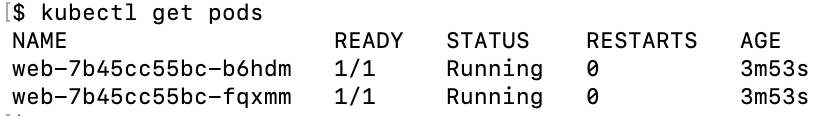  

- replicas를 2로 설정해서 Nginx 파드 2개가 실행됐다.

## 파드 삭제 후 자동 복구
`kubectl delete pod (pod name)` 
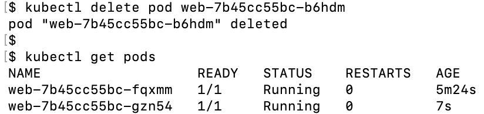  

- 파드를 지우자 바로 새 파드가 만들어져, 지운 직후 조회에서도 `Running` 파드가 2개였다.

## 확인한 점
- 파드를 지운 직후에도 `kubectl get pods`에 파드가 2개로 유지됐고, 새 파드는 AGE가 7초였고, 기존 파드는 5분 24초였다.
- 지운 파드와 이름이 다른 파드가 새로 만들어졌다. 같은 파드를 되살리는 게 아니라 새로 만든다는 점을 알 수 있었다.
- 어제 compose에서는 Tomcat을 `stop`하면 직접 `start`할 때까지 멈춰 있었는데, Kubernetes는 지워도 자동으로 개수를 맞췄다.

## Service로 파드에 접속
설정 파일: [service.yaml](service.yaml)

`kubectl apply -f service.yaml`
`kubectl get service web`  
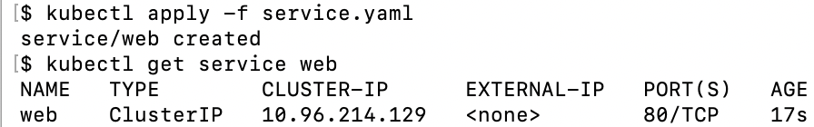  

- Service를 만들어 `app: web` 라벨이 붙은 파드를 앞에 고정 주소를 만들었다.

### Service가 파드를 찾았는지 확인
`kubectl describe service web` 
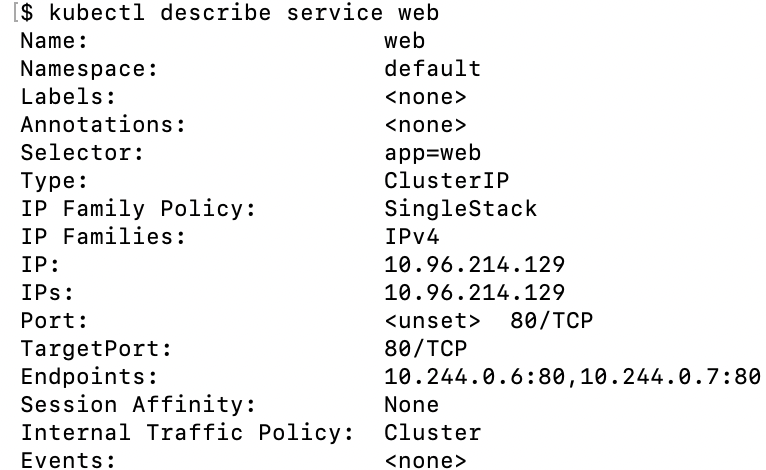  

- `Endpoint`에 보인 IP가 파드 2개의 IP와 동일했다.

### 브라우저에서 접속
`kubectl port-forward service/web 8082:80`  
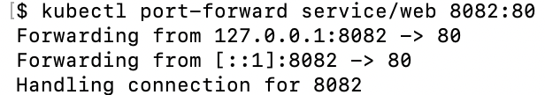   
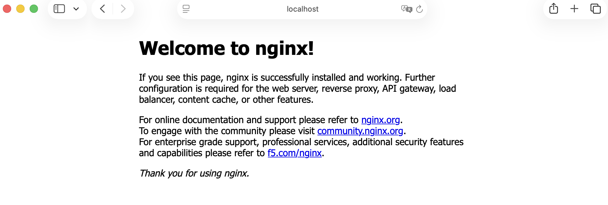  

- localhost:8082에서 Nginx 기본 화면이 떴다.

### 확인한 점
- `kubectl describe service web`의 `Endpoints`에 IP 2개가 보였고, `kubectl get pods -o wide`의 파드 IP와 같았다. Service가 selector의 라벨로 파드를 찾아 연결한다는 것을 확인했다.
- `ClusterIP`로 만든 Service는 클러스터 안에서만 쓰는 주소라서, 내 컴퓨터 브라우저에서 보려면 port-forward가 필요했다.

## 롤링 업데이트와 롤백
이미지 버전을 바꿔 파드가 교체되는 과정을 확인하고, 잘못되 버전을 올린 뒤 되돌려 본다.

### 버전 변경
`kubectl set image deployment/web nginx=nginx:1.27` 
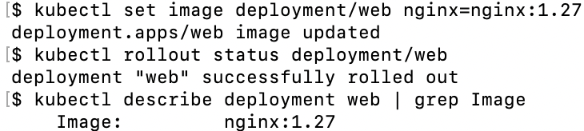 

`kubectl set image deployment/web nginx=nginx:1.28 && kubectl get pods -w` 
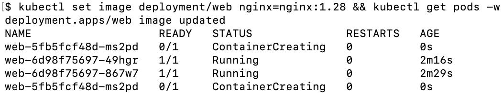 

- 새 파드가 먼저 만들어지고 옛 파드가 하나씩 Terminating이 됐다.  

`kubectl get replicasets`  
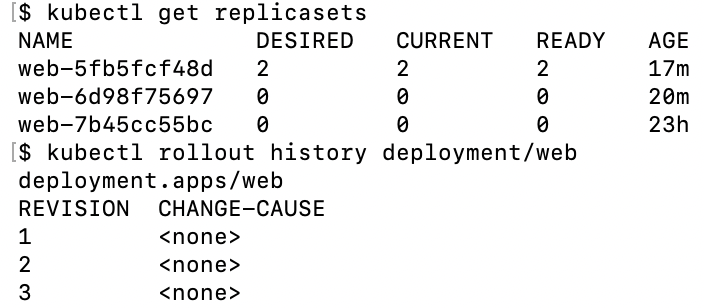  

- 새 ReplicaSet은 파드 2개, 옛 ReplicaSet은 파드 0개로 남아 있었다.

### 잘못된 이미지와 롤백
`kubectl set image deployment/web nginx=nginx:9.99.99` 
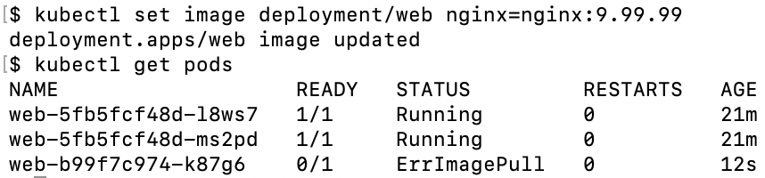 

`kubectl rollout undo deployment/web` 
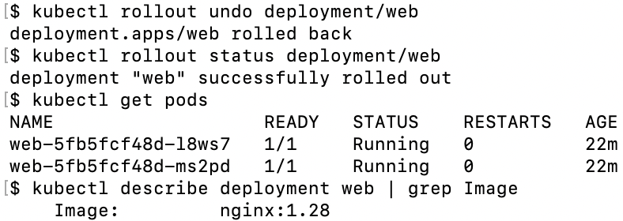 

- 이전 버전 `nginx:1.28`로 돌아왔다.

### 확인한 점
- 존재하지 않는 이미지(`nginx=nginx:9.99.99`)로 `kubectl set image`를 실행해도 `image updated`가 나와서 명령 자체에는 에러가 없었다. `kubectl get pods`에서야 새 파드가 `ErrImagePull`로 보였고, 기존 파드 2개는 `Running`으로 유지됐다.
- `set image`는 원하는 상태만 바꾸는 명령이라, 이미지가 실제로 없다는 사실은 파드가 이미지를 받을 때 드러난다는 점을 알았다.
- `kubectl rollout undo`로 되돌리자 `rolled back`이 나왔고, `Image`가 `nginx:1.28`로 돌아왔다. 기존 파드는 한번도 내려가지 않았어서 AGE가 그대로였다.

## Tomcat 배포

### Deployment 적용
`kubectl apply -f tomcat-deployment.yaml`  
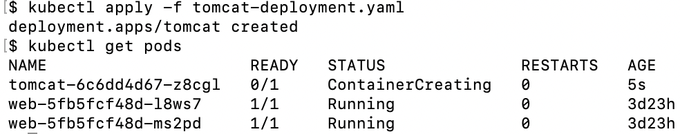  
- 처음에는 이미지를 받는 동안 `ContainerCreating` 이었다. 

### 시작 로그 확인
`kubectl logs deployment/tomcat --tail=5`  
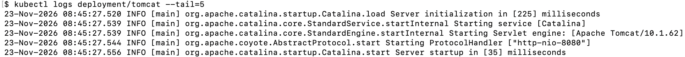  

### 포트 포워딩으로 접속
`kubectl port-forward deployment/tomcat 8083:8080` 
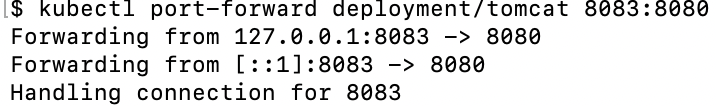   

- localhost:8083에서 Tomcat의 404 화면이 떴다.  
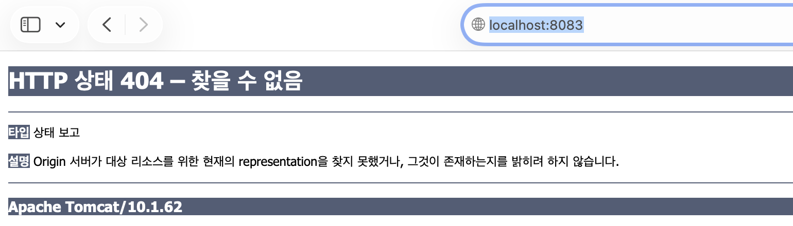  

### 확인한 점
- Service 없이 `kubectl port-forward`만으로도 접속이 됐다.
- 404는 Tomcat까지 연결은 됐는데, 올려둔 파일이 없어서 나오는 응답이다.

## Tomcat에 Service 연결
Tomcat에 Service를 만들고, 클러스터 안의 Nginx 파드에서 이름으로 호출해 본다.

### Service 적용
`kubectl apply -f tomcat-service.yaml` 
`kubectl describe service tomcat` 
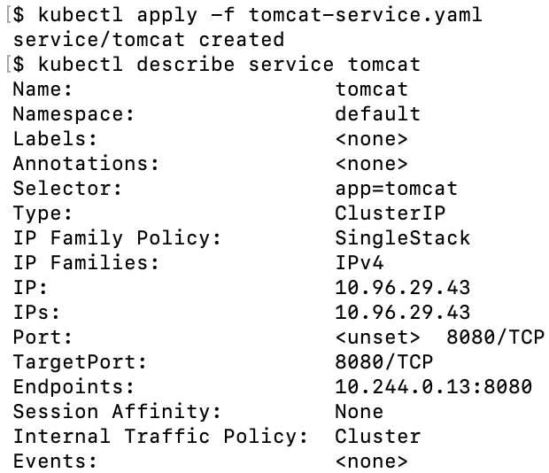  

- `Selector`가 `app=tomcat`이고, `Endpoints`에 Tomcat 파드 IP가 보였다.

### 클러스터 안에서 이름으로 호출
`kubectl exec deploy/web -- curl -s -o /dev/null -w "%{http_cod}" http://tomcat:8080`  
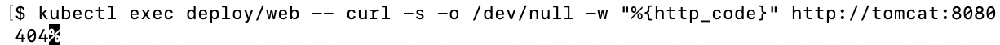  

- Nginx 파드 안에서 `http://tomcat:8080`을 호출하자 `404`가 나왔다.

### 확인한 점
- Service는 `selector`의 라벨로 파드를 찾아 연결하고, 클러스터 안에서는 Service 이름(`tomcat`)이 곧 주소로 쓰인다.
- 클러스터 안에서 부를 때는 port-forward가 필요 없고, 내 컴퓨터 브라우저처럼 클러스터 밖에서 볼 때만 필요하다. 

## Nginx에서 Tomcat으로 프록시 (ConfigMap)
Nginx 설정을 ConfigMap으로 만들어 파드에 마운트하고, Service 이름으로 Tomcat에 프록시한다.

### ConfigMap 적용
`kubectl apply -f nginx-configmap.yaml` 
`kubectl apply -f deployment.yaml` 

### 막혔던 점
`kubectl get pods` 
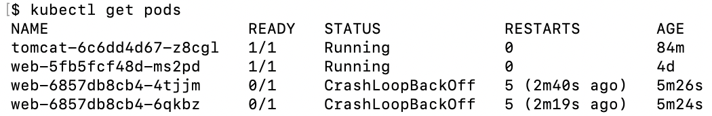  

`kubectl logs web-6857db8cb4-4tjjm` 
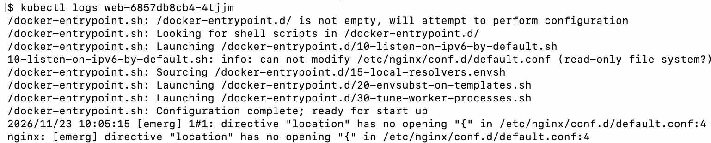  

- 새 파드가 `CrashLoopBackOff`가 되고 `rollout status`가 끝나지 않았다. 옛 파드는 `Running`이라 서비스는 유지됐다.
- 로그에 `directive "location" has no opening "{"`가 나와서, ConfigMap의 설정 문법이 잘못된 것을 알았다.
  `location /` 줄에 여는 중괄호  `{`가 빠져 있어서 추가했다.
- ConfigMap을 고친 뒤에도 파드는 그대로라서, `kubectl rollout restart deployment/web`으로 새 파드를 만들었다.
 
### 해결 후 확인 
`kubectl rollout restart deployment/web` 
`kubectl get pods` 
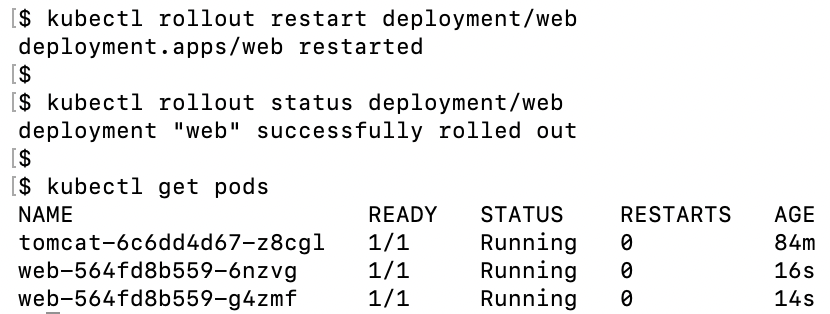  

### 브라우저에서 확인  
`kubectl port-forward service/web 8082:80`  
- `localhost:8082` 에서 Nginx 기본 화면 대신 Tomcat의 404 화면이 떴다. Nginx가 요청을 Tomcat Service로 넘긴 것이다.  
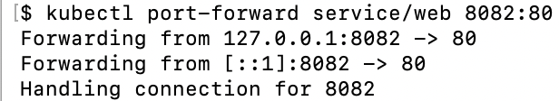  
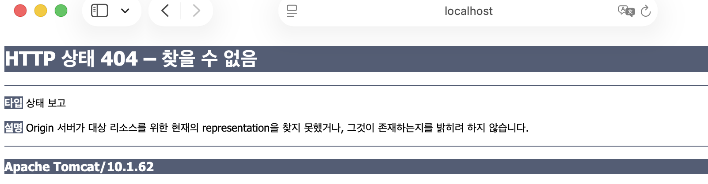  

### 확인한 점
- ConfigMap은 Step 5에서 쓴 볼륨 마운트와 같은 역할이다.
- 설정이 틀리면 새 파드만 죽고 옛 파드는 남아서 서비스는 유지된다. 이유는 `kubectl logs`의 `[emerg]` 줄에서 찾았다. 

## Tomcat을 내려서 502 재현
Tomcat을 0개로 줄여서, Nginx 뒤쪽 서버가 없을 때 어떤 응답이 나오는지 확인한다.

### Tomcat 0개로 줄이기
`kubectl scale deployment tomcat --replicas=0`  
`kubectl get pods`  
`kubectl describe service tomcat`  
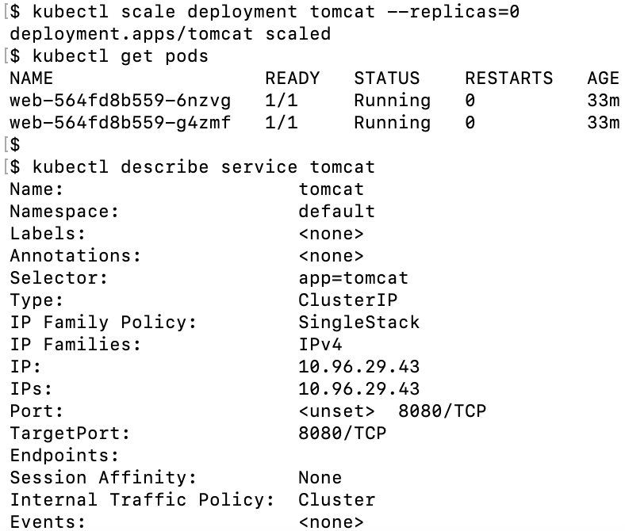 

- Tomcat 파드가 사라졌고, Service의 `Endpoints`가 `<none>`이 됐다.

### 브라우저에서 확인
`kubectl port-forward service/web 8082:80`  
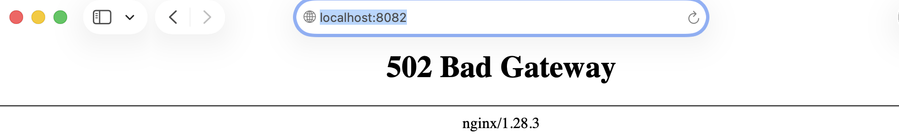  

- `localhost:8082`에서 `502 Bad Gateway`가 떴다. Nginx 파드는 `Running`인데 뒤쪽 Tomcat에 연결이 안되는 상태이다.

### Nginx 로그 확인
`kubectl logs -l app=web --tail=3 --prefix` 
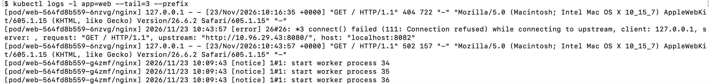  

### 복구
`kubectl scale deployment tomcat --replicas=1` 
`kubectl get pods`  
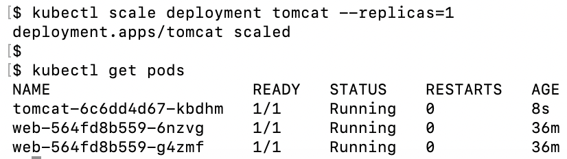 
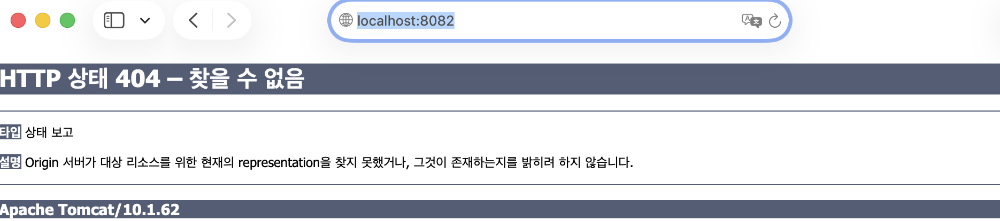 

- Tomcat 파드가 다시 `Running`이 됐고, 브라우저에서 404로 돌아왔다.

### 확인한 점
- Tomcat이 내려가도 Nginx 파드는 `Running`이라, 파드 상태만 봐서는 문제를 알 수 없었다. Nginx 로그에서 upstream 연결 실패를 보고 원인을 찾았다.