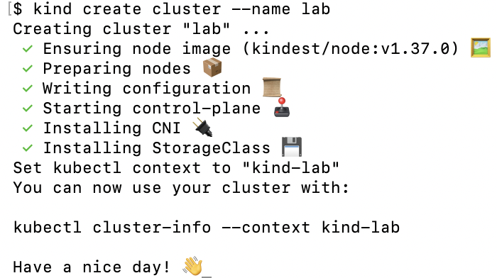
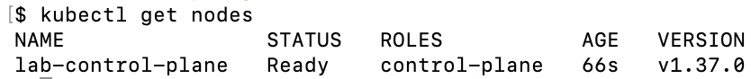

# 01. Kubernetes (kind) 기본 구성

## 목표
kind로 로컬 클러스터를 만들고, Deployment로 Nginx 파드를 2개 유지하게 한 뒤, 파드를 지웠을 때 자동으로 복구되는지 확인한다.

## 클러스터 생성
`kind create cluster --name lab`     
 
`kubectl get nodes` 
  

## Deployment 적용
설정 파일: [deployment.yaml](deployment.yaml)

`kubectl apply -f deployment.yaml` 
`kubectl get pods` 
  

- replicas를 2로 설정해서 Nginx 파드 2개가 실행됐다.

## 파드 삭제 후 자동 복구
`kubectl delete pod (pod name)` 
  

- 파드를 지우자 새 파드가 바로 생성됐고 몇초 뒤 바로 2개가 됐다.

## 확인한 점
- 파드를 지운 후에도 `kubectl get pods`에 파드가 2개로 유지됐고, 새 파드는 AGE가 몇 초로 짧았다.
