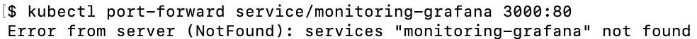
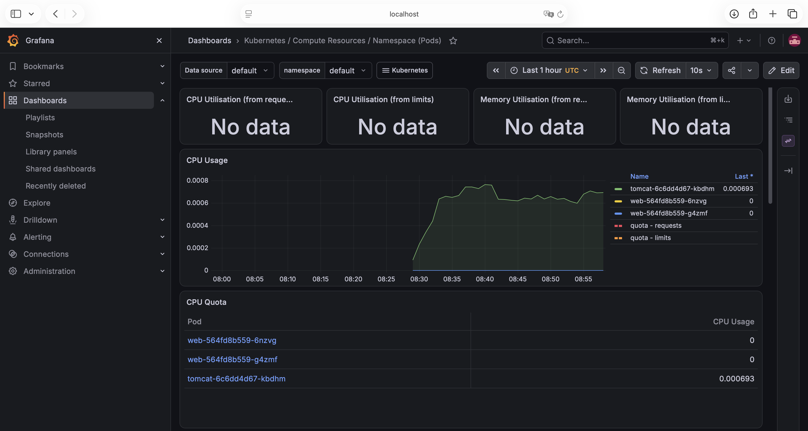
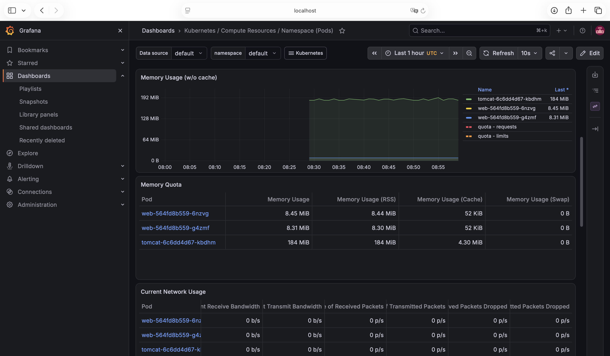

# 03. 모니터링 (Prometheus + Grafana)

## 목표
Helm으로 Prometheus와 Grafana를 설치해서, 클러스터 안 파드의 상태를 수치와 그래프로 볼 준비를 한다.

## Helm으로 설치
`helm repo add prometheus-community https://prometheus-community.github.io/helm-charts` 
`helm install monitoring prometheus-community/kube-prometheus-stack --namespace monitoring --create-namespace --set prometheus-node-exporter.hostRootFsMount.enabled=false` 
  

- `STATUS: deployed`가 나왔다.

## 설치된 파드 확인
`kubectl get pods -n monitoring` 
  

- `monitoring` 네임스페이스에 파드 6개가 `Running`이 됐다.

## 확인한 점
- 명령 한 줄로 Prometheus, Grafana 등 여러 구성 요소가 함께 설치됐다. Helm이 필요한 설정 파일들을 한 묶음으로 설치해 준다는 것을 알았다.

## Grafana 접속
Grafana는 클러스터 안의 Service라서, 내 컴퓨터 브라우저에서 확인 하려면 port-forward가 필요하다.

### 막혔던 점
`kubectl port-forward service/monitoring-grafana 3000:80` 
`kubectl port-forward -n monitoring service/monitoring-grafana 3000:80` 
  

- `-n monitoring` 없이 실행했더니 `services "monitoring-grafana" not found`가 발생했다. 네임스페이스를 지정하지 않으면 `default`에서 찾기 때문이었다. `-n monitoring`을 붙여서 해결했다.

### default 네임스페이스 파드 확인
`Kubernetes / Compute Resources / Namespace (Pods)` 대시보드에서 `namespace`를 `default`로 선택했다. 
  
 

- `web-...` 2개와 `tomcat-...` 1개가 목록에 보였다.
- CPU는 `tomcat`이 `0.000693`, `web`은 둘 다 `0` 이었다.
- 메모리는 `tomcat`이 184 MiB, `web`이 8.45 MiB와 8.31 MiB였다. Tomcat이 Nginx 보다 20배 넘게 많았다.

### 확인한 점
- 직접 만든 Nginx/Tomcat 파드가 따로 설정하지 않았는데도 Grafana에서 확인이 됐다. Prometheus가 클러스터의 파드를 자동으로 수집한다.
- 위쪽 `Utilisation` 패널 4개가 `No data`인 것은 우리 Deployment에 `resources`(requests/limits)를 설정하지 않아서 비교할 기준이 없기 때문이다.
- Tomcat은 Java 프로세스라서 아무 요청이 없어도 Nginx 보다 메모리를 훨씬 많이 사용한다.
