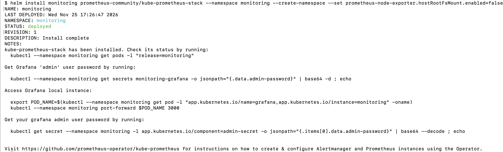
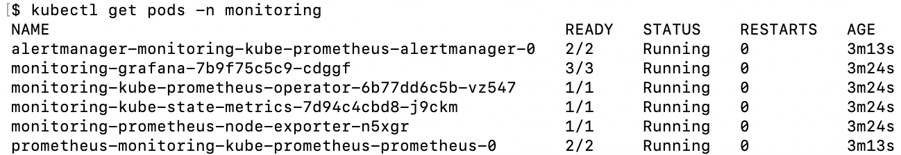

# 03. 모니터링 (Prometheus + Grafana)

## 목표
Helm으로 Prometheus와 Grafana를 설치해서, 클러스터 안 파드의 상태를 수치와 그래프로 볼 준비를 한다.

## Helm으로 설치
`helm repo add prometheus-community https://prometheus-community.github.io/helm-charts` 
`helm install monitoring prometheus-community/kube-prometheus-stack --namespace monitoring --create-namespace --set prometheus-node-exporter.hostRootFsMount.enabled=false` 
  

- `STATUS: deployed`가 나왔다.

## 설치된 파드 확인
`kubectl get pods -n monitoring` 
  

- `monitoring` 네임스페이스에 파드 6개가 `Running`이 됐다.

## 확인한 점
- 명령 한 줄로 Prometheus, Grafana 등 여러 구성 요소가 함께 설치됐다. Helm이 필요한 설정 파일들을 한 묶음으로 설치해 준다는 것을 알았다.