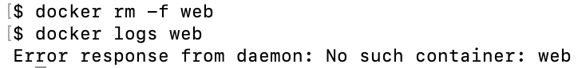
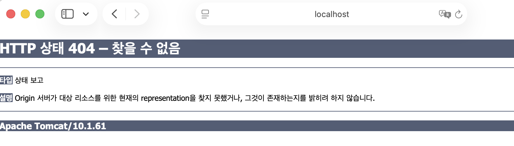
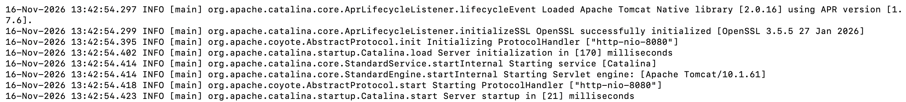
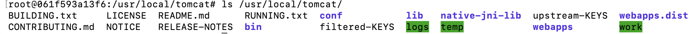
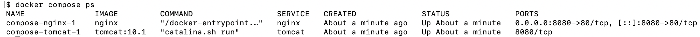
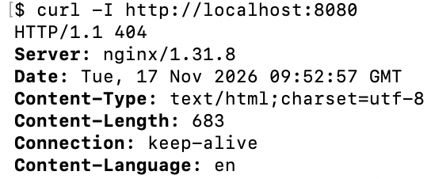

# 01. Nginx 컨테이너 실행

## 목표
서버에 직접 설치하지 않고 Docker로 Nginx를 실행해 보고, 컨테이너가 어떻게 동작하는지 확인한다.

## 실행한 명령어
`docker run -d --name web -p 8080:80 nginx`
`docker ps`
`docker logs web`

## 결과
- localhost:8080에서 Nginx 기본 페이지가 뜬다.

## 확인한 점
- 명령 한 줄로 웹서버 실행
- `-p 8080:80`은 내 컴퓨터 8080 포트를 컨테이너 80 포트로 연결한다.

## 로그와 컨테이너 내부 확인
`docker logs web`
`docker exec -it web bash`
`cat /etc/nginx/conf.d/default.conf`

- 브라우저를 새로고침할 때마다 access 로그가 한 줄씩 쌓인다.

- 컨테이너 안에서 Nginx 설정 파일을 확이한다.

## 확인한 점
- 기존 서버에서는 access.log 파일을 열어 확인을 했는데, 컨테이너에서는 로그가 파일이 아니라 출력으로 연결되어 있어서 `docker logs`로 확인했다.

`access.log`가 `/dev/stdout` 으로 연결돼 있어서 로그가 파일이 아니라 출력으로 나가고, 그래서 `docker logs`로 볼 수 있다.

- 컨테이너를 삭제하면 로그도 함께 사라진다는 점이 기존 서버와 달랐다.

`docker rm -f web` 으로 컨테이너를 지운 뒤 `docker logs web`을 실행하자 "No such container" 오류가 났다.

## 막혔던 점과 해결
- GitHub에서 README를 먼저 만들어 둔 상태로 push해서 `rejected` 오류가 났다. `git pull --rebase` 로 원격 변경을 받은 뒤 다시 push해서 해결했다.

# 02. Tomcat 컨테이너 실행
`docker run -d --name tomcat -p 8081:8080 tomcat:10.1`

- localhost:8081에서 Tomcat이 응답하다. 기본 앱이 비어 있어서 404 화면이 나왔다.

- `docker logs tomcat`으로 기동 로그를 확인했다.

- 컨테이너 안의 Tomcat 폴더 구조를 확인했다.

## 확인한 점
- 404 화면 하단에 `Apache Tomcat/10.1.61`이 표시되어 실행된 버전을 바로 확인할 수 있었다.
- 기동 로그에 `http-nio-8080`이 보였다. 컨테이너 안의 Tomcat은 8080을 쓰므로 `-p 8081:8080`으로 연결해야 접속된다.
- 로그의 `Server startup in [21] milliseconds`로 기동 시간을 확인했다. 배포된 앱이 없는 상태라 빠르게 기동됐다.
- `bin`, `conf`, `lib`, `logs`, `webapps`, `work`, `temp` 구성이 기존에 쓰던 Tomcat과 같았다.

## 막혔던 점과 해결
- 처음에 `-p 8081:80`으로 실행해서 접속이 되지 않았다. Tomcat은 컨테이너 안에서 8080을 쓰므로 `-p 8081:8080`으로 다시 만들어 해결했다.

# 03. Nginx -> Tomcat 연동 (docker compose)
설정파일: [docker-compose.yml](compose/docker-compose.yml), [nginxl.conf](compose/nginx.conf)

- docker compose로 Nginx와 Tomcat을 함께 실행하고, Nginx가 Tomcat(8080)으로 요청을 전달하도록 구성했다.
- 같은 compose 안에서는 서비스 이름(`tomcat`)으로 서로를 찾을 수 있어서, `proxy_pass http://localhost:8080;`으로 설정했다.

`docker compose ps`

`curl -I http://localhost:8080`

- Nginx를 거쳐 Tomcat의 404 응답이 확인됐다.

## 막혔던 점과 해결
- 연동 후에도 `localhost:8080`에 Tomcat 404가 아니라 Nginx 기본 화면이 떴다.
- docker compose exec nginx cat /etc/nginx/conf.d/default.conf`로 컨테이너 안을 확인하니 내 설정이 아니라 기본 설정이었다.
- 원인은 `docker-compose.yml`의 볼륨 경로에 `/etc`가 오타로 들어가 있어서 설정 파일이 연결되지 않은 것이었다.
- 오타를 고치고 `docker compose down`후 `docker compose up -d`로 다시 띄워 해결했다.

## 확인한 점
- 컨테이너가 이상하게 동작할 때는 `docker compose exec`로 컨테이너 안의 실제 설정을 직접 열어 보면 원인을 빨리 좁힐 수 있다.

