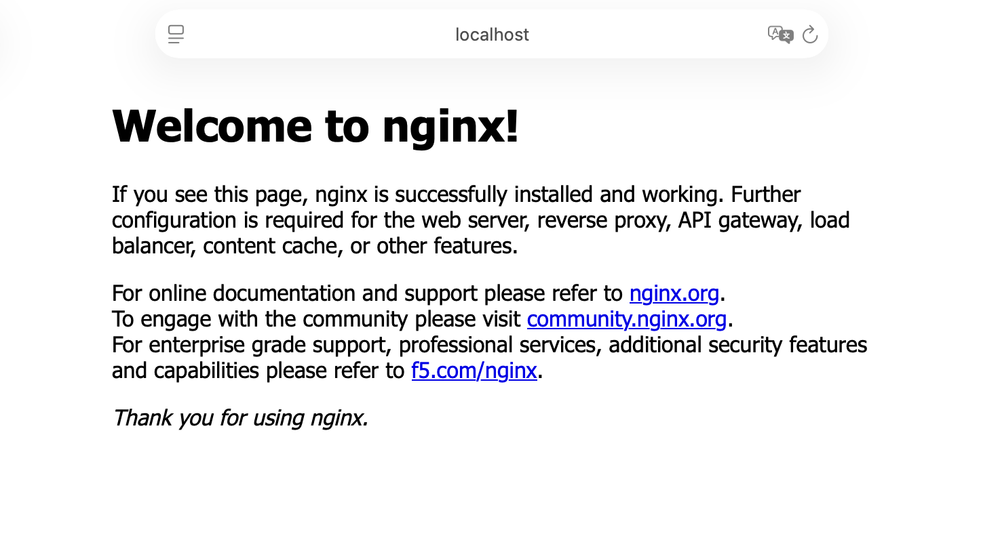

# 01. Nginx 컨테이너 실행

## 목표
서버에 직접 설치하지 않고 Docker로 Nginx를 실행해 보고, 컨테이너가 어떻게 동작하는지 확인한다.

## 실행한 명령어
`docker run -d --name web -p 8080:80 nginx`
`docker ps`
`docker logs web`

## 결과
- localhost:8080에서 Nginx 기본 페이지가 뜬다.

## 확인한 점
- 명령 한 줄로 웹서버 실행
- `-p 8080:80`은 내 컴퓨터 8080 포트를 컨테이너 80 포트로 연결한다.

