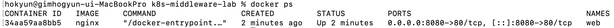
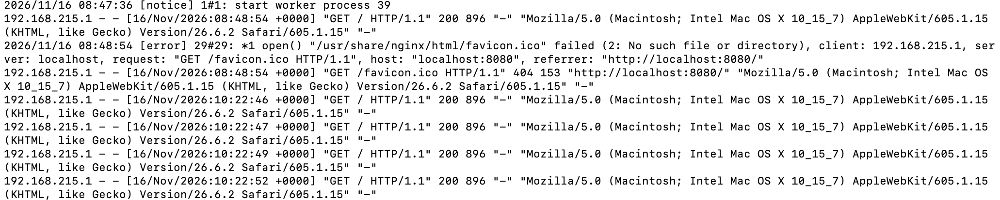
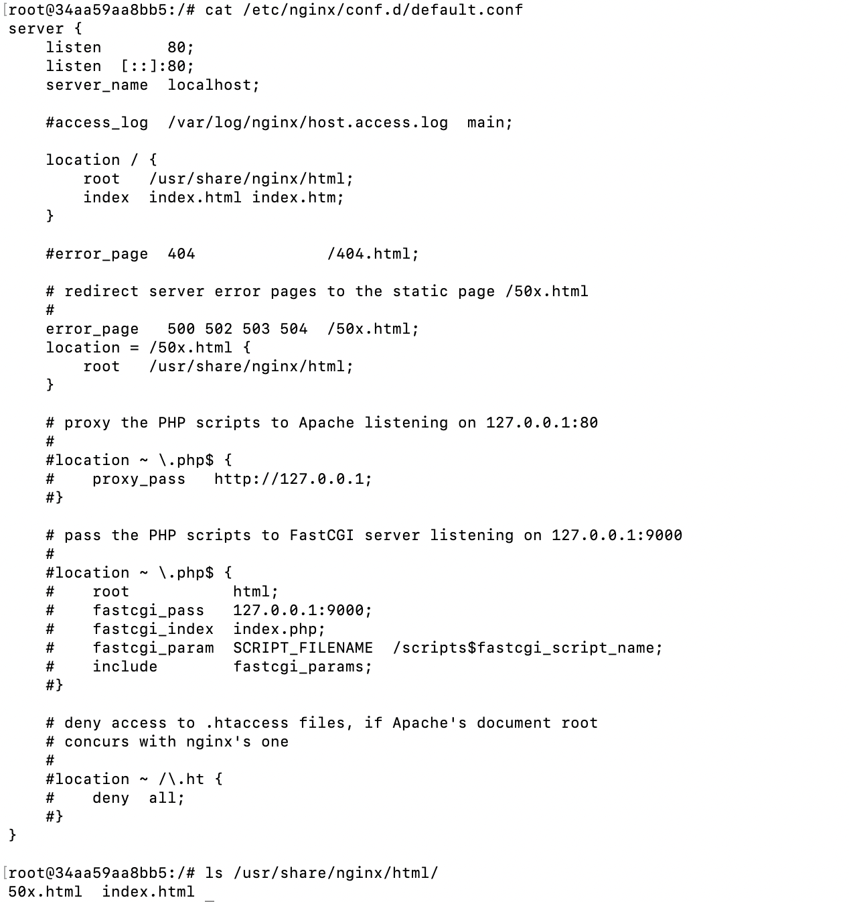
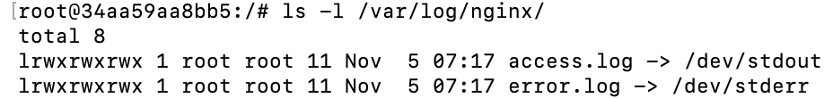

# 01. Nginx 컨테이너 실행

## 목표
서버에 직접 설치하지 않고 Docker로 Nginx를 실행해 보고, 컨테이너가 어떻게 동작하는지 확인한다.

## 실행한 명령어
`docker run -d --name web -p 8080:80 nginx`
`docker ps`
`docker logs web`

## 결과
- localhost:8080에서 Nginx 기본 페이지가 뜬다.

## 확인한 점
- 명령 한 줄로 웹서버 실행
- `-p 8080:80`은 내 컴퓨터 8080 포트를 컨테이너 80 포트로 연결한다.

## 로그와 컨테이너 내부 확인
`docker logs web`
`docker exec -it web bash`
`cat /etc/nginx/conf.d/default.conf`

- 브라우저를 새로고침할 때마다 access 로그가 한 줄씩 쌓인다.

- 컨테이너 안에서 Nginx 설정 파일을 확이한다.

## 확인한 점
- 기존 서버에서는 access.log 파일을 열어 확인을 했는데, 컨테이너에서는 로그가 파일이 아니라 출력으로 연결되어 있어서 `docker logs`로 확인했다.

`access.log`가 `/dev/stdout` 으로 연결돼 있어서 로그가 파일이 아니라 출력으로 나가고, 그래서 `docker logs`로 볼 수 있다.

- 컨테이너를 삭제하면 로그도 함께 사라진다는 점이 기존 서버와 달랐다.

`docker rm -f web` 으로 컨테이너를 지운 뒤 `docker logs web`을 실행하자 "No such container" 오류가 났다.

## 막혔던 점과 해결
- Github에서 README를 먼저 만들어 둔 상태로 push해서 `rejected` 오류가 났다. `git pull --rebase` 로 원격 변경을 받은 뒤 다시 push해서 해결했다.

